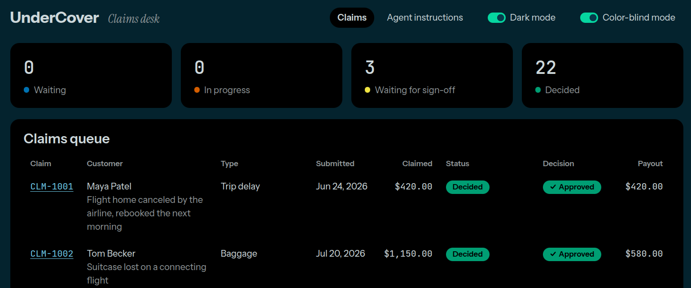

# The UnderCover pilot, with three additions

This comes from following Ed Donner's course on Udemy, [AI FDE: The Forward Deployed Engineer & Agentic AI Architect](https://www.udemy.com/course/ai-fde-forward-deployed-engineer-agentic-ai-architect/): *The complete roadmap to FDE and AI Architect with Agent Harness Engineering, LangGraph, ADLC, MCP, AWS AgentCore, Evals*.

Week 1 Day 3 is a forward deployed engineer (FDE) build exercise. The client is UnderCover Travel Insurance. Its documents say what the business needs (`docs/SPEC.md`) and set the tech choices (`docs/TECH_STACK.md`). As its FDE, I directed a coding agent, Claude Code, to build the pilot from them:

1. The agent plans the pilot.
2. I review the plan.
3. The agent implements it, with every check passing.
4. I review and test the result, and sign it off.

The aim of this write-up is to share what I came up with: the pilot, three additions of my own, and my takeaways. My build is here: https://github.com/dallaire44/undercover/tree/week1day3_FDE

In this write-up:

- [The application](#the-application): what the pilot does, with a screenshot of my additions
- [What was built](#what-was-built): the six phases of the pilot, then my three additions in Phases 7 to 9
- [My takeaways](#my-takeaways): a plan in small parts, each proven before the next; reviewing the plan as the one in charge; human in the loop as a guardrail; and code quality, drilling down into one part of it, Ruff's Pylint rules
- [References](#references)

## The application

UnderCover Travel Insurance is a fictional travel insurer whose three claims handlers work through a queue of claims by hand. The pilot gives them the UnderCover Agent and a dashboard.

- **The agent works each claim.** It reads the customer's story and documents, their policy and claim history, and the policy wording. Then it approves, declines or refers the claim and works out the payout. It explains its decision in two or three sentences, giving the section of the policy that applies.
- **The dashboard shows the team its work.** It has the queue and where each claim stands, each claim in full with the agent's decision, the agent's steps as it works, and its instructions.
- **A handler signs off big payouts.** A payout over $1,000 waits for a handler's sign-off before it is paid.

It is built with FastAPI and SQLite, LangChain's `create_agent` on OpenRouter, and React with Vite and TypeScript.



*The claims queue with all three of my additions: dark mode (Phase 7), color-blind mode with a check on each Approved decision (Phase 8), and the Decision and Payout columns (Phase 9).*

## What was built

Claude Code planned the pilot from `docs/SPEC.md` into `docs/PLAN.md`, then built it phase by phase. Each phase was built with tests, checked against its success criteria, and committed through the pre-commit hook.

- **Phases 1 to 6, the pilot.**
  - A FastAPI and SQLite backend whose `pay_claim` refuses a payout over $1,000 until a handler signs off, however the agent behaves.
  - The UnderCover Agent, using `create_agent` with one tool per API call. It takes its instructions from the API and posts each step to the backend.
  - The dashboard: the queue, each claim in full, the agent's steps as it works, sign-off and the instructions page.
  - Playwright tests that run on their own backend and database.
  - Real runs on four claims, including one over $1,000 that was signed off in the dashboard.
- **Phases 7 and up, my additions.** Each one went into the customer's documents first (`docs/SPEC.md` or a new `docs/ACCESSIBILITY.md`), then became a phase in `docs/PLAN.md` with success criteria, then was built and checked.
  - **Phase 7, a light and dark switch.** The mode is one attribute on `<html>`, set before the page draws, so the wrong mode never flashes on load. That was proven by reading the attribute before the app ran.
  - **Phase 8, a color-blind mode.** First the brand colors were simulated under protanopia, deuteranopia and tritanopia (Machado et al., 2009), and the color differences measured. An Okabe-Ito mapping was then chosen and documented. For protanopia, it more than doubles the difference between Approved and Declined, from 17.2 to 37.2. The mode is off by default, so the brand is unchanged. When on, it also adds a check, a cross or an arrow to each decision.
  - **Phase 9, Decision and Payout columns on the queue.**

The final `npm run check` passes: pytest (44 tests, 97% coverage), vitest (31 tests, 98%) and Playwright (12 tests).

Root causes found before fixing, rather than guessed:
- The agent guessed policy ids until its instructions said to read the claim first.
- A handler's sign-off raced the agent's own payment, and the backend's "already paid" check kept it to one payment.
- A Vite dev server served a half-edited file.
- Chrome's "Auto Dark Mode for Web Contents" was repainting the dashboard, color-blind palette included. Pages cannot opt out of it.

## My takeaways

### A plan in small parts, each proven before the next

What made this build work was the structure of the plan. It has nine phases, each one small, focused and discoverable:

- **Small and focused.** Each phase has one goal and its own success criteria (71 in all), and each became a single commit of between 146 and about 1,250 changed lines. A problem showed up in the phase that caused it, while the change was still fresh: the database-reset bug in Phase 2, the type errors in Phase 3, and the two color tests that the queue's new columns broke in Phase 9.
- **Discoverable.** Anyone can find what was built, why, and how it was proven, without reading all the code. For the color-blind mode, the why is in `docs/ACCESSIBILITY.md`, the what and its criteria are Phase 8 of `docs/PLAN.md`, and the change is the one commit "Pilot phase 8: a color-blind mode".
- **Divide, prove, then build on it.** This is not quite divide and conquer in the computer-science sense, where the pieces are independent. Here the agent needs the backend, and the dashboard needs both. What makes it work is that each part must pass its own success criteria before the next one starts. Without those criteria, the plan would just be a to-do list.

It also explains my next two takeaways. Reviewing the plan works because each phase is small enough to review, and the checks work because each phase is small enough to fix.

### Review the plan: I'm the boss

As Ed says, reviewing the plan is where the expertise is built. The coding agent proposes, and I decide:

- **The pilot's plan listed its decisions for me to review.** For example, the $1,000 rule is enforced in the backend rather than the prompt, the model never sees a customer's contact details or date of birth, and a referral counts as decided.
- **Each of my additions went through the documents first.** It went into the customer's documents (`docs/SPEC.md`, or a new `docs/ACCESSIBILITY.md`), then became a phase in `docs/PLAN.md` with success criteria. I reviewed that before saying "implement".
- **The design calls were mine.** For example, the color-blind mode appears only when a handler turns it on, so UnderCover's brand stays the default.
- **Tough questions paid off.** When I asked whether any smells had really been found, the answer was re-checked against every commit, not taken from memory.

### Human in the loop, as a guardrail

Most of the guardrails in this build are automated. They guard two things: the quality of the code, and whether the app achieves its goals as the spec sets them out.

| Guardrail | What it guards | When it runs |
|---|---|---|
| Ruff, ESLint and Prettier | Code quality: smells, likely bugs and style | Before every commit, in the hook |
| pyright and tsc | Code quality: types | Before every commit, in the hook |
| pytest and vitest, with 80% coverage | The goals, piece by piece. For example, `pay_claim` refuses a payout over $1,000 until a handler signs off | Before every commit, in the hook |
| Playwright end-to-end tests | The goals, for the whole app. For example, a handler's sign-off in the dashboard releases a held payment | In `npm run check`, before handing over |
| Each phase's success criteria | That each phase delivers what the plan promised | Claude checks each one before ticking it |

These can only enforce what can be written down as a rule. A human in the loop covers what they can't: judgment, taste and accountability. In this build there is a human in the loop at two levels, the product and the build. At both, an automated rule and a person work together.

- **In the product, a handler signs off big payouts.** The agent can approve any claim, but a payout over $1,000 waits for a handler. The backend's `pay_claim` refuses the payment until a handler signs off, however the agent behaves, so the model cannot skip the human. In a real run, the agent approved CLM-1003 for $3,750.00 and tried to pay it. The backend refused, and the payment went out only after a handler, Dana Whitfield, signed off in the dashboard. When the agent tried to pay again, the backend refused it as "already paid", so exactly one payment was made.
- **The agent hands judgment calls to people.** Its instructions say to refer a claim when it needs a handler's judgment or more information. Across the 25 claims in my queue, it referred 6 to a handler, and 3 approvals over $1,000 are still waiting for sign-off.
- **People can see what the agent did.** The claim page shows every step the agent took, and its instructions are visible, read only. A handler can check the agent's reasoning before signing off.
- **In the build, I was the human in the loop.** The automated checks and each phase's success criteria caught what could be specified. I decided what couldn't be: the plan before "implement", the planned phase for each of my additions, and design calls such as keeping the brand as the default. Claude Code never pushed anything, and changes outside the plan came to me first, as questions or plans to approve.

The pattern is the same at both levels. The agent proposes, automated rules hold the hard limits, and a person makes the judgment calls and is accountable for them.

### Code quality

One of my takeaways is code quality. Many things in this project contribute to it:

- The structure of the plan. Every change went from a requirement in the docs, to a phase with checkable success criteria, to the build, the checks and a commit.
- The code standards in `docs/CODE_STANDARDS.md`.
- Type checking with pyright and tsc in strict mode.
- Unit tests with an 80% coverage threshold, and end-to-end tests in the browser.
- A pre-commit hook that runs the checks on every commit.
- The linters.

With this many moving parts, it is easy to skim them all and learn little about any one. So the rest of this write-up drills down into just one of them: Ruff's Pylint rules. I look at what they check, how Claude Code runs them, and what happened in this build. The other parts are for another time. Ruff's Pylint rules come from one line in `docs/PROCESS.md`:

> Python: ruff (lint and format), pyright, and pytest with 80% coverage

Ruff includes many of Pylint's rules, including its refactor checks (the `R` messages). These flag code smells of the kind catalogued in Martin Fowler's *Refactoring: Improving the Design of Existing Code*. The `"PL"` in `pyproject.toml` turns them on:

```toml
[tool.ruff.lint]
select = ["E", "F", "W", "I", "B", "SIM", "UP", "PL", "S", "PT", "FAST", "C90", "PLR1702"]
```

### How Claude Code runs these checks, and how often

That line in `docs/PROCESS.md` describes the checks rather than running them. They are run by `npm run check:python` in `package.json`:

```
uv run ruff format --check && uv run ruff check && pyright && uv run pytest -q
```

Each step runs only if the one before it passed. pytest takes its coverage settings from `pyproject.toml`: `--cov`, with `fail_under = 80`.

Claude Code comes to them in four ways:

1. **It reads the rule.** `AGENTS.md` is loaded into every Claude Code session automatically. It says to read the docs in full, `PROCESS.md` among them, before planning or building.
2. **It runs the checks itself while building.** `PROCESS.md` says to build each phase with tests and to check every success criterion. So Claude runs `npm run check:python` after each change, and again after each fix.
3. **The pre-commit hook runs them on every commit.** `PROCESS.md` says to commit after each phase. On any commit that stages a Python file under `backend/` or `agent/`, `lefthook.yml` formats the staged files with Ruff, then runs `npm run check:python`. If a step fails, the commit is refused. `PROCESS.md` says to fix the problem and commit again, and never to use `--no-verify`. The TypeScript files get the same treatment in parallel, with Prettier, ESLint, tsc and vitest. the hook came with the course's starter repo
4. **It runs everything at the end.** After the last phase, and before handing work over, Claude runs `npm run check`: the Python checks, then the TypeScript checks, then Playwright.

How often, in this build: 5 of the 18 commits on my branch changed Python files, so the hook ran the Python checks on them (Phases 1, 2, 3, 5 and 9). Claude's own runs during each phase came first, so every one of those hook runs passed the first time. Those earlier runs caught three problems:

- **pytest:** in Phase 2, resetting the database tried to drop SQLite's internal `sqlite_sequence` table.
- **pyright:** in Phase 3, three type errors in the agent, from how LangChain types its messages and stream chunks.
- **ruff:** in Phase 5, a line too long in `agent/main.py`, fixed by extracting a `describe()` function.

### What happens when a smell is detected

Ruff reports a smell, but it does not fix it:

1. `ruff check` lists each smell with its line, its rule and a message, then exits with code 1. It changes no code.
2. The chain stops. `pyright` and `pytest` do not run, and `npm run check:python` fails.
3. When Claude is running the checks while building, it reads the report, refactors the code and runs the checks again until they pass. For example, it might introduce a parameter object, extract a function, name a magic value as a constant, or turn `else: if` into `elif`.
4. When the hook runs them at commit time, the commit is refused and nothing is committed. Claude fixes the problem and commits again, and never uses `git commit --no-verify`.
5. Silencing a smell is not allowed. `docs/PROCESS.md` says: "Never lower a threshold, turn off a rule or exclude a file to get a green run. If a rule looks wrong, stop and ask."

Nothing is fixed automatically. Some rules, such as `PLR5501`, are marked as fixable with `ruff check --fix`, but neither the checks nor the hook pass `--fix`. The hook only reformats code, with `ruff format`. So every smell gets a deliberate refactoring.

### Were any smells found in this build?

No Pylint smell was found from the start of implementing `docs/PLAN.md`:

- **While building:** the only lint finding in Claude's runs was the line-length error above. It comes from Ruff's `E501` rule, not a Pylint rule.
- **In every commit:** I re-checked the Python code at each of the five commits that changed it. Each passes the project's rules. With every Pylint and complexity rule switched on, including the preview rules this project leaves off, the app code still has no findings.
- **The check does work:** the same command finds the smells in the example below. In the test code, it finds 33 magic values, which the project allows in tests on purpose.

Two caveats:

- "No findings" means no smells that these rules can detect, not that the code has none.
- Claude wrote the code knowing these limits, so it stayed under them by design.

One rule was silenced. Three SQL queries in `backend/db.py` and `backend/records.py` carry an inline `# noqa: S608`. That is a security rule against building SQL with f-strings. It is a false positive there, since the table names come from fixed lists in the code, not from user input. By a strict reading of `PROCESS.md`, Claude should have asked before adding it.

### Example smells the refactor checks catch

| Rule | What it flags (limit in this project) | Fowler's smell | Refactoring that fixes it |
|---|---|---|---|
| `PLR0913`, `PLR0917` | Too many arguments or positional arguments (5) | Long Parameter List | Introduce Parameter Object |
| `PLR1702` | Too many nested blocks (5) | Long Function, deep nesting | Replace Nested Conditional with Guard Clauses |
| `PLR0912`, `PLR0915` | Too many branches (12) or statements (50) | Long Function | Extract Function, Decompose Conditional |
| `PLR2004` | A magic value in a comparison | Magic numbers | Replace Magic Literal |
| `PLR5501` | `else` then `if` instead of `elif` | Needless nesting | Flatten to `elif` (no named refactoring) |
| `SIM102` (flake8-simplify, also selected) | Nested `if`s that could be one `if` | Needless nesting | Consolidate Conditional Expression |

This deliberately smelly function, checked with this project's settings:

```python
def settle(claim, policy, plan, payments, handler, notes):
    """Work out what to pay on a claim."""
    total = 0
    for item in claim["items"]:
        if item["amount"] > 0:
            if item["category"] == "baggage":
                for payment in payments:
                    if payment["item"] == item["description"]:
                        if payment["amount"] > 0:
                            total -= payment["amount"]
    if claim["type"] == "baggage" or claim["type"] == "passport":
        total -= 100
    if total > 1000:
        return "sign-off"
    else:
        if total == 0:
            return "decline"
    return None
```

```
line 1:  PLR0913 Too many arguments in function definition (6 > 5)
line 1:  PLR0917 Too many positional arguments (6 > 5)
line 4:  PLR1702 Too many nested blocks (6 > 5)
line 5:  SIM102  Use a single `if` statement instead of nested `if` statements
line 8:  SIM102  Use a single `if` statement instead of nested `if` statements
line 13: PLR2004 Magic value used in comparison, consider replacing `1000` with a constant variable
line 15: PLR5501 Use `elif` instead of `else` then `if`, to reduce indentation
```

In the build itself:
- The $1,000 limit lives in `data/company.json` and is read into a `LIMIT` constant in `backend/decisions.py`, so the code has no magic `1000`. Tests are exempt from `PLR2004`, since they compare against literal values on purpose.
- A Ruff line-length error in `agent/main.py` led to a small Extract Function, `describe()`.
- The dashboard gets the same treatment from ESLint: `complexity` (15), `max-depth` (4), `max-params` (5) and the SonarJS rules. SonarJS made every component's props read-only in Phase 4.

## References

- Ruff's rules, with the Pylint (`PL`) section: https://docs.astral.sh/ruff/rules/
- The rules above: [too-many-arguments](https://docs.astral.sh/ruff/rules/too-many-arguments/), [too-many-positional-arguments](https://docs.astral.sh/ruff/rules/too-many-positional-arguments/), [too-many-nested-blocks](https://docs.astral.sh/ruff/rules/too-many-nested-blocks/), [too-many-branches](https://docs.astral.sh/ruff/rules/too-many-branches/), [too-many-statements](https://docs.astral.sh/ruff/rules/too-many-statements/), [magic-value-comparison](https://docs.astral.sh/ruff/rules/magic-value-comparison/), [collapsible-else-if](https://docs.astral.sh/ruff/rules/collapsible-else-if/), [collapsible-if](https://docs.astral.sh/ruff/rules/collapsible-if/)
- Ruff's settings, including the Pylint limits, and its preview rules: https://docs.astral.sh/ruff/settings/, https://docs.astral.sh/ruff/preview/
- Pylint's checkers, including the refactoring checker: https://pylint.readthedocs.io/en/stable/user_guide/checkers/features.html
- Martin Fowler, *Refactoring: Improving the Design of Existing Code*, 2nd edition: https://martinfowler.com/books/refactoring.html
- Martin Fowler on code smells: https://martinfowler.com/bliki/CodeSmell.html
- The catalog of refactorings: https://refactoring.com/catalog/, including [Introduce Parameter Object](https://refactoring.com/catalog/introduceParameterObject.html), [Extract Function](https://refactoring.com/catalog/extractFunction.html), [Decompose Conditional](https://refactoring.com/catalog/decomposeConditional.html), [Replace Nested Conditional with Guard Clauses](https://refactoring.com/catalog/replaceNestedConditionalWithGuardClauses.html), [Consolidate Conditional Expression](https://refactoring.com/catalog/consolidateConditionalExpression.html) and [Replace Magic Literal](https://refactoring.com/catalog/replaceMagicLiteral.html)
