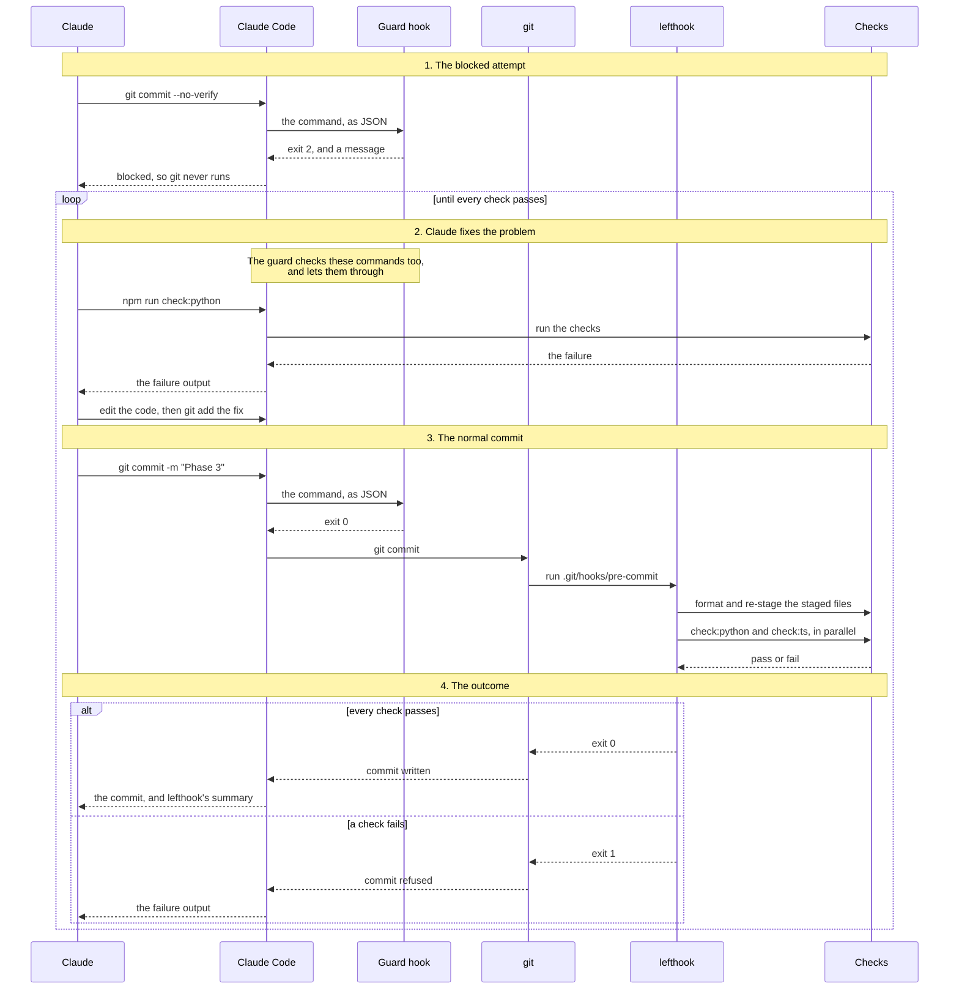
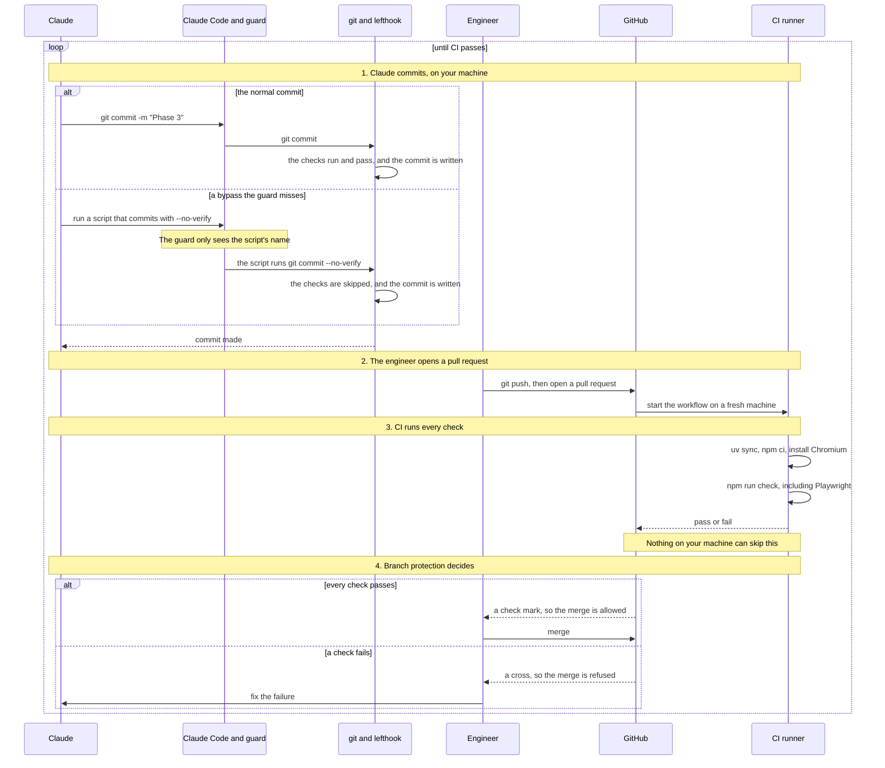

# The pre-commit hook and lefthook

Notes on the "git pre-commit hook" that `docs/PROCESS.md` mentions: where it is, what lefthook is, where it came from, whether Claude Code can skip it, how a Claude Code hook works alongside it, what CI is, what each of them costs, whether the hook's format check is redundant, and how to catch a bypass or a failure in a run.

## Where the hook is

The hook is managed by **lefthook**, and it lives in three places.

1. **The config, which is checked in:** `lefthook.yml` at the repo root. This is the file to edit.

   ```yaml
   pre-commit:
     parallel: true
     jobs:
       - name: python        # runs when staged files match {backend,agent}/**/*.py
         ... uv run ruff format {staged_files}  (re-stages the fixes)
         ... npm run check:python
       - name: typescript    # runs when staged files match {dashboard,e2e}/** or *.config.*
         ... npx prettier --write -u {staged_files}  (re-stages the fixes)
         ... npm run check:ts
   ```

   Each group runs its steps in order and stops at the first failure, which refuses the commit. The two groups run in parallel. A commit that touches neither kind of file, such as a Markdown edit, skips both.

2. **The installer:** `package.json` has `"prepare": "lefthook install && playwright install chromium"`. `npm install` runs `prepare` automatically, which is what `PROCESS.md` means by "`npm install` ... install[s] ... a git pre-commit hook". The `"lefthook": false` under `allowScripts` only blocks lefthook's own postinstall script, so `prepare` is the one path that installs the hook.

3. **The installed hook:** `.git/hooks/pre-commit`, a small shell script that calls the lefthook program in `node_modules/`. Lefthook then reads `lefthook.yml`. Git doesn't track this file, so a fresh clone needs `npm install` before the hook works.

The checks themselves are defined in `package.json`:

- `check:python` runs `ruff format --check`, `ruff check`, `pyright` and `pytest`.
- `check:ts` runs `prettier --check`, `eslint`, `tsc` and `vitest` with coverage.

The Playwright end-to-end tests aren't in the hook. They only run with the full `npm run check`, which matches `PROCESS.md`: "The pre-commit hook runs the format, lint, type and unit test checks on every commit." `guides/14_setting_up_a_project.md` has a section on the hook.

## What lefthook is

Lefthook is an external app, not a library. It's an open-source git hooks manager made by Evil Martians: https://github.com/evilmartians/lefthook. Nothing in UnderCover imports it. It's a separate program that git runs when you commit.

**How it gets into the repo:**

- It's a dev dependency in `package.json` (`"lefthook": "^2.1.14"`), so `npm install` downloads it into `node_modules/`.
- Lefthook is written in Go, so it's a single compiled program, not JavaScript. The npm package just delivers that program. The `lefthook` package downloads a second package for your system, such as `lefthook-linux-x64`, which contains the actual program at `node_modules/lefthook-linux-x64/bin/lefthook`. The version here is 2.1.14.
- npm is used because the dashboard already needs `npm install`, so one command sets up everything. Lefthook can also be installed with Homebrew, `go install` and other package managers.

**When you commit:**

1. git runs `.git/hooks/pre-commit`, the small script that `lefthook install` wrote.
2. That script finds the lefthook program in `node_modules/` and runs `lefthook run pre-commit`.
3. Lefthook reads `lefthook.yml`, checks which staged files match each glob, and runs the matching jobs. If any job fails, the commit is refused.

The best-known alternatives are **Husky**, which is JavaScript-only, and **pre-commit**, a Python tool configured with `.pre-commit-config.yaml`. Lefthook suits this repo because it mixes Python and TypeScript, and lefthook doesn't care what language the checks are in. It also runs the Python and TypeScript groups in parallel and only on staged files, which keeps commits fast.

## Where it came from

Lefthook wasn't added because of `docs/PLAN.md`. It was already in the repo before the plan existed. Ed added it as part of the project skeleton on `main`, and the plan never mentions it.

**The evidence:**

- `lefthook.yml` first appears in Ed's commit `85b14a9` on 2026-09-26, "Repo ready and documentation finalized for main build at w1d3". The same commit has the `lefthook` dev dependency and the `prepare` script in `package.json`.
- `docs/PLAN.md` was first committed on 2026-10-23 (`f984fce`, Pilot phase 1), almost a month later. It contains no mention of "hook" or "commit".
- The pilot build never touched `lefthook.yml`. It changed `package.json` in only two places: phase 1 added a `reset` script, and phase 5 added `--reload-dir agent` to `dev:backend`.

**Which way the dependency runs:**

- The skeleton, which includes `lefthook.yml`, `package.json`, `pyproject.toml` and the configs for ESLint, pyright and the rest, came first. It's the harness Ed set up for the coding agent.
- `docs/PROCESS.md` describes that harness as something that already exists. It then tells the agent how to work inside it: commit after each phase, and if the hook fails, fix the problem and commit again.
- `docs/PLAN.md` is the agent's plan for the product. It assumed the hook was there and didn't need to plan it.

So the docs describe the hook; they didn't cause it to be added. This is the course's "harness" idea from Week 1 Day 3: the human sets up the guardrails before the agent writes any code, and the agent works inside them. `guides/for_agents/AGENT_GUIDE_WEEK1.md` lists the lefthook pre-commit hook among the repo's controls.

## Can Claude Code skip the hook?

In the Week 1 Day 3 lecture, Ed says lefthook runs every check except Playwright on each commit. He says Claude Code could skip it with a flag, which is unlikely, and becomes even less likely once `PROCESS.md` forbids it. He adds that Claude Code's own hooks could make it "completely bulletproof".

| Claim | Verdict |
|---|---|
| Coverage shows which code paths ran, not how good the tests are | Correct |
| Lefthook runs everything except Playwright on every commit | Mostly correct. It runs only the part that changed: a commit with only Python files skips the TypeScript checks, and a commit with only docs runs nothing. |
| Claude could skip it with a flag | Correct: `git commit --no-verify`, or `-n` for short. There are other ways too: `LEFTHOOK=0 git commit` (the installed `.git/hooks/pre-commit` exits early when it sees that), `git -c core.hooksPath=... commit`, or deleting the hook file. |
| `PROCESS.md` says not to | Correct. Its Rules section says "Never use `git commit --no-verify`" and "Never lower a threshold, turn off a rule or exclude a file to get a green run." It doesn't name `LEFTHOOK=0`. |
| Claude Code hooks make it completely bulletproof | Overstated, as explained below |

### How a Claude Code hook helps

The rule in `PROCESS.md` works only if the model reads it and obeys it. A hook is a program that Claude Code runs itself, outside the model.

1. A `PreToolUse` hook runs before every tool call, including every Bash command.
2. Claude Code sends the hook the call as JSON, with the command in `tool_input.command`.
3. If the hook exits with code 2, Claude Code blocks the call and passes the hook's error message back to Claude. Claude then learns why and fixes the failing check instead.

According to the Claude Code docs, a blocking hook overrides allow rules, so it applies even when Bash commands are pre-approved or you're in auto mode.

### What it looks like

There are two files. The script is a `.mjs` file because `PROCESS.md` requires that everything works on Windows.

`.claude/settings.json`:

```json
{
  "hooks": {
    "PreToolUse": [
      {
        "matcher": "Bash",
        "hooks": [
          { "type": "command", "command": "node \"${CLAUDE_PROJECT_DIR}/.claude/hooks/guard-commit.mjs\"" }
        ]
      }
    ]
  }
}
```

`.claude/hooks/guard-commit.mjs`:

```js
import { readFileSync } from "node:fs";

const { tool_input } = JSON.parse(readFileSync(0, "utf8"));
const bypasses = [/--no-verify/, /\bgit\b.*\bcommit\b.*\s-n\b/, /LEFTHOOK=0/, /core\.hooksPath/];

if (bypasses.some((pattern) => pattern.test(tool_input.command))) {
  console.error("Blocked: the pre-commit checks must run. Fix the failure and commit again.");
  process.exit(2);
}
```

These patterns were tested against sample commands. They block all four bypasses: `--no-verify`, `-n`, `LEFTHOOK=0` and `core.hooksPath`. They allow a normal `git commit -m "..."`, as well as `git log -n 5` and `npm run check`. The hook hasn't been installed or run inside Claude Code.

Why not just a permission deny rule like `Bash(git commit --no-verify *)`? It only matches when the command starts that way, so `git commit -m "x" --no-verify` gets through. The Claude Code docs warn that rules restricting a command's arguments are fragile and suggest a `PreToolUse` hook instead.

### Why it's still not bulletproof

- **The hook reads the command's text, and text can be disguised.** Claude could put the commit inside a script and run the script, and the hook would never see `--no-verify`.
- **Claude could edit or remove the hook.** The `.claude` and `.git` folders are protected, so Claude Code asks you before writing to them, but `bypassPermissions` mode skips those prompts.

The truly bulletproof control runs where the agent can't reach: CI on the server. A GitHub Actions workflow would run `npm run check` on every pull request, and branch protection would refuse to merge until it passes. Nothing done on your machine can skip that. `PROCESS.md` already says "Never push", so the pull request is where that gate would sit.

In order of strength: the instruction in `PROCESS.md` asks Claude not to bypass the hook, a Claude Code hook enforces that on your machine, and CI enforces it on the server.

## How the Claude Code hook and lefthook work together

They aren't redundant. Both are called hooks, but they belong to two different systems and do two different jobs.

| | Lefthook | Claude Code hook |
|---|---|---|
| Whose hook | git's: runs on git events such as `pre-commit` | Claude Code's: runs on agent events such as `PreToolUse` |
| When it runs | When anyone commits: you, Claude Code, or another agent | Before each command Claude Code runs, and only in Claude Code |
| What it does | Runs the checks: format, lint, types, unit tests | Runs no checks. It reads the command and blocks a bypass. |
| Configured in | `lefthook.yml` | `.claude/settings.json` |

Lefthook is the checker, and the Claude Code hook guards the checker. Neither can do the other's job: the Claude Code hook on its own would test nothing, and lefthook on its own can be skipped.

**When Claude Code commits:**

1. Claude asks to run `git commit -m "Phase 2"`.
2. Claude Code runs the Claude Code hook first. It finds no bypass in the command and exits 0, so the command goes ahead.
3. git runs `.git/hooks/pre-commit`, which runs lefthook, which runs the jobs in `lefthook.yml`.
4. If a check fails, git refuses the commit and Claude sees the failure. It fixes the problem and commits again.

If Claude asks for `git commit --no-verify` instead, the Claude Code hook stops it at step 2, so git and lefthook never run. Claude sees the hook's message and commits the normal way, as [Committing the normal way after a block](#committing-the-normal-way-after-a-block) describes.

**Where they're tied together:** the Claude Code hook knows lefthook's own off switch, `LEFTHOOK=0`. If the repo ever moved to another hooks manager, such as Husky with `HUSKY=0`, the Claude Code hook's patterns would need updating too.

**Gaps that neither one covers:**

- **People and other agents:** the Claude Code hook only watches Claude Code. You, or another coding agent such as OpenCode, can still commit with `--no-verify`.
- **Edits to the config:** Claude could change `lefthook.yml` to drop a job, and both hooks would let that through. `PROCESS.md`'s rule against turning off a rule is the only guard here.
- **Playwright:** neither hook runs the end-to-end tests.

**Where redundancy does appear: CI.** A CI workflow would run the same checks as lefthook a second time, on the server, along with Playwright. That repetition is deliberate. Lefthook gives fast feedback on your machine at each commit, and CI is the gate that nothing on your machine can skip. It also covers all three gaps above.

## Committing the normal way after a block

"Commits the normal way" means Claude runs a plain `git commit` with no bypass, so git runs lefthook and lefthook runs the checks. In practice there's usually a fix to make first. Claude rarely asks for `--no-verify` unless a check is failing, so the normal way normally means fixing that failure and then committing.

This sequence diagram shows the whole run. Each column is one of the entities involved, and time runs downward. The four bands match the four parts below.



**1. The blocked attempt**

1. Claude runs `git commit --no-verify -m "Phase 3"`.
2. Before the command runs, Claude Code runs `guard-commit.mjs`. It matches `--no-verify` and exits with code 2.
3. Claude Code cancels the command, so git never runs and nothing is committed. Claude gets back the hook's message: "Blocked: the pre-commit checks must run. Fix the failure and commit again."

**2. Claude fixes the problem**

1. Claude finds out what's failing, either from the earlier hook output or by running `npm run check:python` or `npm run check:ts` itself.
2. Claude edits the code or the tests to fix it.
3. Claude stages the fixes with `git add <files>`.

**3. The normal commit**

1. Claude runs `git commit -m "Phase 3"`.
2. The Claude Code hook runs again, finds no bypass and exits 0, so the command goes ahead.
3. git runs `.git/hooks/pre-commit`, which runs `lefthook run pre-commit`.
4. Lefthook reads `lefthook.yml`. If you have half-staged files, it hides their unstaged edits first. Then it runs whichever jobs match the staged files, in parallel:
   - **Python:** `ruff format` on the staged files, then `git add` on them. Then `check:python`, which runs `ruff format --check`, `ruff check`, `pyright`, and `pytest` with its 80% coverage threshold.
   - **TypeScript:** `prettier --write` on the staged files, then `git add` on them. Then `check:ts`, which runs `prettier --check`, `eslint`, `tsc`, and `vitest` with coverage.
5. Lefthook restores any edits it hid.

**4. The outcome**

- **Every check passes:** lefthook exits 0 and git writes the commit, including any formatting fixes.
- **A check fails:** lefthook exits non-zero and git refuses the commit, so nothing is committed. Claude sees the failure output and goes back to part 2. This repeats until the checks pass.

This loop is the one in `PROCESS.md`: "Commit. The pre-commit hook runs the checks; if it fails, fix the problem and commit again." During a planned build, it's step 4 of each phase, after Claude checks the success criteria and updates `PLAN.md` and `STATUS.md`.

One caveat: "commits the normal way" is what the hook's message and `PROCESS.md` steer Claude to do, not something they guarantee. After a block, Claude could instead stop and ask you, which is fine. It could also try another way around the hook, such as committing from inside a script. That's the gap described in [Why it's still not bulletproof](#why-its-still-not-bulletproof).

## What CI is

CI stands for continuous integration. Developers merge small changes into the main branch often, and a server checks every change automatically. What matters for this repo is where the checks run: on a fresh machine on the server, not on anyone's laptop, so nothing done locally can skip them.

On GitHub, CI runs on GitHub Actions:

- A workflow is a YAML file in `.github/workflows/`. It says when to run, such as on every pull request, and what to run.
- Each run gets a fresh virtual machine, called a runner, which installs everything from scratch and runs the steps.
- The result shows on the pull request as a check mark or a cross. Branch protection, a repo setting, can refuse to merge a pull request until the check passes.

UnderCover has no CI today: the repo has no `.github/` folder, and the course doesn't cover CI. A workflow for this repo could look like this, as `.github/workflows/check.yml`:

```yaml
name: check
on:
  pull_request:
  push:
    branches: [main]
jobs:
  check:
    runs-on: ubuntu-latest
    steps:
      - uses: actions/checkout@v7
      - uses: astral-sh/setup-uv@v10
      - uses: actions/setup-node@v7
        with:
          node-version-file: .nvmrc
          cache: npm
      - run: uv sync
      - run: npm ci
      - run: npx playwright install --with-deps chromium
      - run: npm run check
```

- `npm ci` is a clean install from `package-lock.json`. Its `prepare` script also installs lefthook and Chromium, and the next step adds the system libraries Chromium needs on Linux.
- It needs no API keys, because `PROCESS.md` says tests never call a model.
- It runs `npm run check`, so it covers Playwright, which the git hook skips.
- The action versions are the latest releases as of October 2026: checkout v7, setup-uv v10 and setup-node v7. This workflow hasn't been run.

### The bulletproof version, as a sequence diagram

This diagram adds CI to the run in [Committing the normal way after a block](#committing-the-normal-way-after-a-block). It shows the worst case: a bypass the guard misses, so the checks on your machine are skipped, and CI still catches it before the merge. It puts Claude Code and its guard in one column, and git and lefthook in another, because the first diagram already shows their details.



1. **Claude commits on your machine.** Usually the commit goes through lefthook. In the worst case, Claude runs a script it wrote earlier with the Write tool, and the script commits with `--no-verify`. The guard only sees a command like `bash commit.sh`, so it lets it through, and the checks are skipped.
2. **The engineer pushes and opens a pull request.** It's the engineer, not Claude, because `PROCESS.md` says "Never push".
3. **CI runs every check on a fresh machine.** That includes Playwright, which the git hook never runs.
4. **Branch protection decides.** A failing check refuses the merge, so a skipped check on your machine can't reach `main`. The engineer sends the failure back to Claude, and the loop starts again.

This is bulletproof only with the right settings and one habit:

- **Branch protection** must require the check, require a pull request for `main`, and apply to admins too. Otherwise anyone, including an agent with your credentials, could push straight to `main`.
- **The workflow file is code in the pull request.** For a pull request, GitHub runs the workflow as the pull request changes it, so an edit to `.github/workflows/check.yml` could weaken the checks. The engineer's review of the diff is what catches that.

CI is often paired with CD, continuous delivery: once the checks pass, the server deploys the build automatically.

## What the hooks cost

Measured on this machine on 2026-10-27, with the pilot's tests:

| | Lefthook | Claude Code hook | CI |
|---|---|---|---|
| Money | Free | Free | Free on a public repo like yours. A private repo on GitHub Free gets 2,000 free minutes a month, then pays $0.006 a minute on Linux. |
| Time | About 10 s for a Python commit, 13 s for a TypeScript one, and 13 s for both, since they run in parallel. None for a docs-only commit. | 10 to 20 ms per Bash command | Not measured. The checks take 27 s locally, plus a fresh install on each run. |
| Upkeep | The globs in `lefthook.yml` must match the folders | Its patterns, and their false positives | The workflow file and its action versions |

**Lefthook:**

- The wait comes with every commit, and it grows with the suite. The format step works on the staged files only, but the checks run the whole suite for that part. `check:python` took 9.7 s, of which pytest took 3.5 s for 44 tests; the rest was ruff and pyright.
- The agent commits after each phase, so it pays that wait many times in a build.
- A failing check costs more than the wait. Its output goes into the agent's context, so each attempt at a fix costs tokens.
- A slow hook tempts people to skip it with `--no-verify`, which is a reason to keep the hook to the fast checks.
- It does nothing until `npm install` runs on that clone.

**The Claude Code hook:**

- It starts Node before every Bash command Claude runs, which takes about 10 to 20 ms each time.
- Its patterns read the command's text, so they block some harmless commands. Tested: `git commit -m "Handle the -n flag"`, a commit message that mentions `--no-verify`, and `echo LEFTHOOK=0` were all blocked. Claude sees the message and can reword, so the cost is a retry.
- Its patterns need updating if the tools change, and it only covers Claude Code.

**CI:**

- Feedback is slower: it comes after a push, not at the commit, and each run installs everything from scratch first.
- The workflow needs upkeep, such as moving to new action versions.
- A flaky test, one that fails at random, blocks merges until it's fixed.

**The trade-off:** each layer runs the checks it can afford. The fast checks run at each commit, in about 13 s. The Playwright tests run with `npm run check` before hand-over, in about 27 s for everything. CI would repeat it all on the server as the final gate.

## Is the format check redundant?

The Python job formats the staged files, then runs `check:python`, which starts with `ruff format --check`. So the hook formats, then checks the formatting. Is the second step redundant? Partly, but the duplication is cheap and deliberate.

### The fix step in the code

`lefthook.yml`, with comments added here:

```yaml
    - name: python
      glob: "{backend,agent}/**/*.py"    # run this job only if the commit has Python files here
      group:
        piped: true                      # run the jobs below in order, and stop at the first failure
        jobs:
          - run: uv run ruff format {staged_files}   # 1. fix: format the Python files in the commit
            stage_fixed: true                        #    then git add them, so the fixes go into the commit
          - run: npm run check:python                # 2. check everything, and change nothing
```

`package.json`:

```json
"check:python": "uv run ruff format --check && uv run ruff check && pyright && uv run pytest -q",
```

Here's what happens when a commit has a formatting slip, such as `x = {'a':1}` in `backend/main.py`:

1. `{staged_files}` is lefthook's list of the staged files that match the glob, so step 1 runs `uv run ruff format backend/main.py`. It rewrites the line as `x = {"a": 1}`.
2. `stage_fixed: true` makes lefthook run `git add` on those files, so the commit gets the formatted version, not the one you staged.
3. `npm run check:python` runs, and `ruff format --check` passes. If the rest passes, the commit goes through.

Without step 1, `ruff format --check` would fail and `piped: true` would stop there, so git would refuse the commit. Here's that check on the same line, in a scratch file:

```text
$ uv run ruff format --check /tmp/slip.py
unformatted: File would be reformatted
 --> /tmp/slip.py:1:6
  |
  - x = {'a':1}
1 + x = {"a": 1}
  |

1 file would be reformatted          (exit code 1)

$ uv run ruff format /tmp/slip.py
1 file reformatted

$ uv run ruff format --check /tmp/slip.py
1 file already formatted             (exit code 0)
```

Only formatting gets fixed. A lint error, a type error or a failing test still refuses the commit, because fixing one takes a decision, not a formatter.

### What each format step looks at

- `uv run ruff format {staged_files}` fixes only the Python files in the commit, then re-stages them.
- `ruff format --check` checks every Python file in `backend/` and `agent/`, as they are on disk. `pyproject.toml` sets ruff's `include` to `backend/**/*.py` and `agent/**/*.py`, the same folders as the lefthook glob.

So after step 1, `ruff format --check` can't fail on the files in the commit. It can only fail on a Python file in those folders that isn't part of the commit and isn't formatted: a file you changed but didn't stage, or a new file you haven't added. During a pre-commit, lefthook hides the unstaged edits in files that are partly staged, but it leaves files you haven't staged at all as they are (see `internal/run/controller/guard.go` in lefthook's source). So the check can refuse a commit over a file that isn't in it. That's more of a quirk than a protection. When Claude commits everything after each phase, it never comes up.

### Why it's built this way

`check:python` is one definition of "the Python checks", used in three places:

| Where | What it needs |
|---|---|
| `npm run check`, before hand-over | Report problems, change nothing, so `--check` is right |
| CI, if you added it | The same: report problems, change nothing |
| The pre-commit hook | Fix formatting rather than refuse the commit over it |

The hook puts a fix step in front so that a formatting slip gets fixed instead of blocking the commit. Without it, the agent would have to run the formatter and commit again, which costs a retry and tokens. Then the hook reuses `check:python` unchanged instead of keeping a second, hook-only copy of the check list in sync.

The duplicate costs almost nothing: `uv run ruff format --check` took 0.03 s, out of 9.7 s for the whole `check:python`.

The TypeScript job follows the same pattern: `npx prettier --write -u {staged_files}` with `stage_fixed: true`, then `npm run check:ts`, which starts with `prettier --check`.

So the duplication is real, but it costs 0.03 s, and it buys one list of checks shared by the hook, `npm run check` and CI. It's worth leaving as it is.

## Catching these in a run: logs and instrumentation

Both work. Claude Code already logs every session, so you can check after a run whether Claude tried to bypass the hook, without adding anything. Instrumentation is what you'd add to watch it as it happens. Neither shows what got committed, because git records nothing about hooks. That takes CI.

### The logs you already have: Claude Code transcripts

Claude Code saves every session as a JSONL file in `~/.claude/projects/<project path>/<session-id>.jsonl`, one JSON line per message. Each Bash call is stored with its exact command, a timestamp and the session ID. Each result is stored too, including lefthook's output and any message a Claude Code hook sends back.

A search of this repo's past sessions, the pilot build and its follow-ups, on 2026-10-28:

| What was searched for | Found |
|---|---|
| `git commit` calls | 31 |
| Bypass attempts (`--no-verify`, `LEFTHOOK=0`, `core.hooksPath`) | 0 |
| Commits lefthook refused | 0 |
| Commits that touched code | All passed: python and typescript show passing jobs |
| Docs-only commits | All jobs skipped |

So lefthook never refused a commit during the pilot. `PILOT.md` records a pytest failure in Phase 2 and pyright errors in Phase 3, so Claude must have caught those by running the checks itself before committing. The hook was a backstop that never had to fire.

The search also showed three limits of logs:

- **Text matching gives false positives.** The search flagged 2 commands, and both turned out to be Mermaid diagram text containing "never --no-verify". The guard hook's patterns would have blocked those harmless commands too.
- **A log only has what the command printed.** One commit ran with `>/dev/null 2>&1`, so its lefthook output isn't in the transcript. It only touched `PILOT.md`, so its jobs would have been skipped anyway.
- **Lefthook's output includes color codes.** They have to be stripped before the output can be searched.

To search the transcripts:

```bash
cat ~/.claude/projects/*undercover*/*.jsonl \
  | jq -r 'select(.type=="assistant") | .message.content[]? | select(.type=="tool_use" and .name=="Bash") | .input.command' \
  | grep -E -- '--no-verify|LEFTHOOK=0|core\.hooksPath'
```

This also searches the session you're in, so any commands in it that contain these words show up too.

### Instrumentation you can add

**A log line in the guard hook.** This is the simplest option. Claude Code passes the hook the session ID, the working directory and the path to the session's transcript, so each block can write one line that says which project it came from and where to read the whole session. Here is `.claude/hooks/guard-commit.mjs` from [What it looks like](#what-it-looks-like), with the log added:

```js
import { appendFileSync, readFileSync } from "node:fs";
import { homedir } from "node:os";
import { join } from "node:path";

const input = JSON.parse(readFileSync(0, "utf8"));
const command = input.tool_input.command;
const bypasses = [/--no-verify/, /\bgit\b.*\bcommit\b.*\s-n\b/, /LEFTHOOK=0/, /core\.hooksPath/];

if (bypasses.some((pattern) => pattern.test(command))) {
  const entry = {
    time: new Date().toISOString(),
    session: input.session_id,
    cwd: input.cwd,
    transcript: input.transcript_path,
    command,
  };
  appendFileSync(join(homedir(), ".claude", "blocked-commits.log"), JSON.stringify(entry) + "\n");
  console.error("Blocked: the pre-commit checks must run. Fix the failure and commit again.");
  process.exit(2);
}
```

Tested with sample input: `git commit -m "Phase 3" --no-verify` exits 2 and writes this line, and `git commit -m "Phase 3"` exits 0 and writes nothing.

```json
{"time":"2026-10-28T20:04:50.246Z","session":"abc123","cwd":"/home/you/undercover","transcript":"/home/you/.claude/projects/-home-you-undercover/abc123.jsonl","command":"git commit -m \"Phase 3\" --no-verify"}
```

**Where the log goes.** The example writes to your home folder, `~/.claude/blocked-commits.log`. That's a sound choice for one person on one machine, but not best practice beyond that:

- **It follows Claude Code's own docs.** The hooks guide's examples log to `~/.claude/bash.log`, `~/.claude/command-log.txt` and `~/claude-config-audit.log`. The log also sits next to Claude Code's session transcripts in `~/.claude/projects/`, and it survives branch switches and fresh clones.
- **Never put it in the repo.** It could be committed by accident. It would also sit inside Claude's working directory, where Claude's file tools could edit the evidence. A log in your home folder is outside it.
- **The operating systems have their own conventions.** On Linux, the XDG base directory spec puts logs in `$XDG_STATE_HOME`, which defaults to `~/.local/state`. macOS and Windows use other folders. `~/.claude/` is simpler, and it works on all three, which matters because `PROCESS.md` requires everything to work on Windows.
- **A local file is weak evidence.** Anything running as you can edit or delete it, including Claude through Bash. For a team or an audit, send the events off the machine to a central collector, which is what Claude Code's OpenTelemetry support below does.

**Claude Code's built-in OpenTelemetry.** This suits a team running many agents. You turn it on with environment variables:

```bash
export CLAUDE_CODE_ENABLE_TELEMETRY=1
export OTEL_LOGS_EXPORTER=console   # or otlp, to send to a collector
export OTEL_LOG_TOOL_DETAILS=1      # include the Bash command text
```

The Claude Code docs list two events that cover this:

- **`claude_code.tool_decision`** with `decision: "reject"` and `source: "hook"` is a call blocked by a `PreToolUse` hook, such as a bypass the guard caught.
- **`claude_code.tool_result`** for Bash includes `git_commit_id` and `git_branch` when a `git commit` succeeds. That gives you a record of every commit the agent made.

This is the same idea as the observability in Week 2, but pointed at the coding agent instead of the UnderCover Agent.

### The git side

Git keeps no record of whether hooks ran. A commit made with `--no-verify` looks exactly like any other, so the repo alone can't tell you whether the checks were skipped. You check the outcome instead, by re-running the checks on what was committed. That's CI's job, and it's the only check that doesn't depend on how the commit was made.

| Question | Where to find the answer |
|---|---|
| Did Claude try to bypass the hook? | Transcripts after the fact, the guard hook's log, or OpenTelemetry's `tool_decision` reject events |
| Did the checks run and pass on each commit? | Lefthook's summary in the commit's result in the transcript, or OpenTelemetry's `tool_result` with `git_commit_id` |
| Does what got committed actually pass? | CI |
