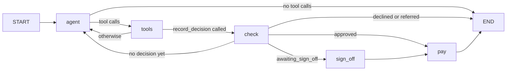

# Plan: approvals that wait, and work that survives a restart

The brief is `docs/DURABLE.md`. This plan builds on the product as `docs/STATUS.md` describes it, after the harness build, in six phases. Each phase ends green on the pre-commit checks and is committed. Tests never call a model: they use the existing `StubModel` (`agent/tests/conftest.py`), and the graph's tests use LangGraph's `InMemorySaver` in place of Postgres, so `npm run check` needs no Supabase, Langfuse or OpenRouter.

SIDENOTE: For consistency with the course, please read `labs/week2day3.ipynb` and build the solution in the same style as the lab. Where the lab and this brief differ, follow the brief.

How this plan follows the lab:

- The claim agent is a `StateGraph` with a `TypedDict` state, an `add_messages` list, plain functions as nodes and small functions as conditional edges, as in Part 2.
- It pauses with `interrupt()` and resumes with `Command(resume=...)`, as in Part 3.
- It is checkpointed by `PostgresSaver` with `autocommit=True`, `prepare_threshold=0`, `row_factory=dict_row` and a `search_path`, and every invoke uses `durability="sync"`, as in Parts 1 and 3.
- Paying has a node of its own, because an interrupted node runs again from the top when it resumes.

Where the brief differs from the lab, it wins:

- The decision is recorded through the backend's `record_decision` tool, not a structured-output `decide` node.
- The graph never compares a payout with the limit. The backend says whether a claim waits for sign-off.
- Payments are the backend's, not a lab table.
- The schema is `undercover`, not `lab`.

## The shape of the build

Today the backend runs the agent in its own process, and the claim agent is `create_agent` with middleware. A claim over $1,000 ends at `awaiting_sign_off`, and the sign-off pays it with no agent involved. Anything the agent was doing when it stopped is lost.

After this build:

- **The backend** keeps the records on Supabase (SQLite in tests) and still enforces every rule. It no longer runs the agent: it asks the agent's service to work a run, or to pick up a claim after a sign-off.
- **The agent's service** (`agent/service.py`, port 8002) is the only place the agent runs. `npm run dev` starts it beside the backend and the dashboard.
- **The claim agent** is a hand-written LangGraph graph, saved to Postgres after every step. It pauses at a sign-off and carries on from its last step after a restart.
- **The queue agent** stays on `create_agent`, now with the same checkpointer, so a run that was stopped is finished rather than started again.

- **agent** calls the model with the claim tools and counts its model calls.
- **tools** runs the tools. A refused backend call goes back to the model as text.
- **check** reads the claim back from the backend after `record_decision`.
- **sign_off** waits on `interrupt()` until a handler signs off.
- **pay** calls `pay_claim` for the decided payout.

### Choices for you to review

1. **The agent runs only in its service.** The backend's `start_run`, `start_agent` and `sign_off` call the service through one client module, `backend/agent_service.py`, and the backend no longer imports `agent`. This is the separation the brief wants for the cloud, and it means one process does the agent's work, so two processes can never carry on the same claim. `uv run -m agent --cap 5` works as it does today: it asks the backend, which asks the service. If the service can't be reached, a new run is stopped with "The agent's service could not be reached". A sign-off stands either way.
2. **Each attempt on a claim has its own thread.** `take_claim` gives the claim a new `thread_id` and stores it on the claim. A claim stopped partway keeps its thread, so it carries on with the same attempt. `return_claim` (a failure with an error) clears the thread, so the next attempt starts afresh on a new one, as today.
3. **The backend decides when the graph waits.** After `record_decision`, the **check** node reads the claim:
   - `awaiting_sign_off`: the graph waits at **sign_off**
   - approved and `in_progress`: it goes straight to **pay**
   - declined or referred: it ends
   - no decision yet, because the decision was refused: it goes back to the model

   The graph never compares a payout with $1,000, and `pay_claim` still refuses any payout over the limit without a sign-off.
4. **A sign-off no longer pays.** `sign_off` records the handler and the time and moves the claim from `awaiting_sign_off` to `in_progress`, so the claim shows "In progress" until it's paid. Once the sign-off is saved, the backend asks the service to pick the claim up, in a background task. The **pay** node then pays it. The payment records who signed off and when, taken from the backend's own sign-off record, so the agent can't misstate it.
5. **A repeat counts as done.** A repeated `record_decision` with the same decision and payout returns the claim. So does a repeated `pay_claim` for the same amount. A different decision, or a different amount, is still refused. Both operations now return the claim, since the brief asks for that. This is what makes it safe for a node to run again after a restart.
6. **Carrying on.** The agent carries on what was left in two places:
   - **When the service starts**, once the backend answers its health check.
   - **At the start of every run.**

   Each time, it first carries on each claim that is `in_progress` from its thread. That covers a claim stopped partway, a claim signed off while the agent was away, and a claim whose thread has no checkpoint yet, which starts on that thread. Then it carries on the run left running, if there is one:
   - a queue run resumes its queue agent from its checkpoint
   - a run on one claim finishes with that claim's line

   A carry-on that fails with an error returns the claim, as `work_claim` does today. Only one carry-on runs at a time.
7. **The backend stops stopping runs on startup.** Today a backend restart marks the run `stopped` and returns its claims, which adds an attempt. Now the agent runs in another process, so a backend restart doesn't interrupt it. A run killed with the agent stays `running` until the agent's next start finishes it. "Stopped" keeps its meaning: the queue agent failed, or it ended without finishing.
8. **`work_claim` carries on its own claims.** When a resumed queue agent repeats `work_claim` on a claim it had already taken, `work_claim` doesn't take the claim again:
   - a claim still `in_progress` is carried on from its thread
   - a claim that has moved on is reported with its outcome line
9. **The graph's nodes take the place of the middleware:**
   - The **agent** node counts model calls in the state and raises past 30. The count is saved, so a restart doesn't reset it.
   - LangGraph's `RetryPolicy` on the **agent** node retries a failed model call twice with backoff, in place of `ModelRetryMiddleware`.
   - `ToolNode`'s `wrap_tool_call` hands a refused backend call back to the model as text. It reuses today's `refusals_as_text` logic.
   - Every message, tool call and tool result is still posted as a step. The pause and the payment are posted too: "Waiting for a handler's sign-off", then "Signed off by Priya Raman. Paid $1,500.00".

   The queue agent keeps its middleware.
10. **One checkpointer, chosen like the database.** When `DATABASE_URL` is set, the agent uses `PostgresSaver` on a `psycopg_pool.ConnectionPool` with at most 4 connections and `search_path=undercover`. Its tables go beside ours. Otherwise it uses `InMemorySaver`, which is what tests and a SQLite dev setup get. The service calls `setup()` when it starts.
11. **The connection budget.** At most 4 connections from the backend (SQLAlchemy `pool_size=4`, `max_overflow=0`) and 4 from the agent's service. That's 8, plus 1 for a reseed, under the 12 the brief allows.
12. **`.env` is passed, never loaded.** `agent/harness.py` stops calling `load_dotenv()`, which today would leak `DATABASE_URL` into the tests. `npm run dev` and `npm run reset` run `uv run --env-file .env ...`. `npm run check` never passes it.
13. **`UNDERCOVER_AGENT` changes meaning.** Today `UNDERCOVER_AGENT=off` stops the e2e backend starting the agent. Now it's the service's address, `http://127.0.0.1:8002` by default. The e2e backend points it at a stand-in on port 8003, `e2e/agent-stand-in.mjs`. The stand-in answers 202 and remembers each request, so a test can check what reached it, and the e2e tests still act as the agent through the API.
14. **Langfuse.** Every claim graph invocation gets Langfuse's `CallbackHandler` and the metadata `langfuse_session_id` set to `"<claim id> <thread id>"`, such as `CLM-1003 9f2c…`. That covers the first run, a carry-on and the resume after a sign-off, so all of one attempt's traces sit in one session. Tracing is on only when `LANGFUSE_PUBLIC_KEY` is set, so tests send nothing.

## The API after this build

New or changed backend operations. Each has an `operation_id`, a one-line docstring and no optional inputs, and `backend/tests/test_openapi.py` keeps checking them.

| Operation | Route | What changes |
|---|---|---|
| `calculate_payout` | `POST /api/policies/{policy_id}/payout` `{benefit, lines, paid_by_others}` | New. The payout rules from `labs/week2day1_payout.py`: the calculation, the payout and whether it needs sign-off, with the limit from `data/company.json` |
| `record_decision` | `POST /api/claims/{id}/decision` | Returns the claim. A repeat of the same decision and payout returns the claim. A different one is 409 |
| `pay_claim` | `POST /api/claims/{id}/payment` `{amount}` | Returns the claim. A repeat for the same amount returns the claim. The payment records the sign-off, if any |
| `sign_off` | `POST /api/claims/{id}/sign-off` `{handler_id}` | Records the sign-off, moves the claim to `in_progress`, then asks the agent's service to pick it up. It no longer pays |
| `take_claim` | `POST /api/runs/{run_id}/claims/{claim_id}` | Gives the claim a new `thread_id` |
| `return_claim` | `POST /api/claims/{id}/return` | Clears the claim's `thread_id` |
| `start_run`, `start_agent` | as today | Ask the agent's service to work the run, or stop it if the service can't be reached |

`ClaimSummary` and `ClaimDetail` gain `run_id` and `thread_id`. `Payment` gains `signed_off_by` (the handler's name) and `signed_off_at`. In every `Line` of a payout request, `quantity`, `nights` and `hours` are required, as are `benefit`, `lines` and `paid_by_others` in the request itself, since operations have no optional inputs.

The agent's service has these operations, under the same API rules:

| Operation | Route | What it does |
|---|---|---|
| `health` | `GET /health` | The service is up |
| `work_run` | `POST /runs/{run_id}` | 202. Carry on, then run the queue agent on the run |
| `work_one` | `POST /runs/{run_id}/claims/{claim_id}` | 202. Carry on, then work one claim and finish the run with its line |
| `resume_claim` | `POST /claims/{claim_id}/resume` | 202. Pick a signed-off claim back up and pay it |

---

## Phase 1: The payout rules and tracing in Langfuse

The two improvements from the Week 2 Day 1 lab, on the agent as it is today.

- `backend/payouts.py`: `work_out_payout` from `labs/week2day1_payout.py`, with the plans read through `db.load("plans")` and the approval limit from `db.load("company")["payout_approval_limit"]`, not a constant.
- `backend/models.py`:
  - `PayoutLine`, with every field required
  - `PayoutRequest`
  - `PayoutStep`, named so it can't be confused with the agent's `Step`
  - `Payout`
- `backend/main.py`: the `calculate_payout` operation, reading the policy with `records.document`.
- `agent/api.py`: `calculate_payout`.
- `agent/tools.py`: the `calculate_payout` tool for the claim agent, with its own `Line` model and descriptions, as `TodoItem` has.
- `backend/instructions/claim.md`: the goal-based instructions gain one rule: work out an approval's payout with `calculate_payout` and record the payout it returns.
- `agent/harness.py`:
  - stops calling `load_dotenv()`
  - `tracing(claim_id, thread_id)` returns the run config, with the Langfuse handler and session id when the keys are set and nothing otherwise
  - `run_claim` passes that config
- `package.json`: `dev:backend` and `reset` use `uv run --env-file .env`.

Success criteria:

- [x] `uv run pytest backend/tests/test_payouts.py` passes. Each payout is checked through the API (`POST /api/policies/{id}/payout`):
  - [x] On POL-2007 (Economy, one traveler), a $239.99 suitcase and three T-shirts at $74.97, with $100 paid by the airline, gives four steps and a payout of $24.97:
    - "Hard-shell suitcase, limited to $150.00", 150.00
    - "Three T-shirts", 74.97
    - "Less what others have paid or refunded", -100.00
    - "Less the deductible", -100.00

    It doesn't need sign-off.
  - [x] On POL-2006 (First), a $3,800.00 hospital bill under emergency medical is $3,800.00 and needs sign-off.
  - [x] With `payout_approval_limit` patched to 5,000, the same claim doesn't need sign-off, so the limit comes from the company settings.
  - [x] Cash over $100 is limited to $100, and an unknown policy is 404.
- [x] An agent test on a stub model calls `calculate_payout`, then records the payout it returned. The tool result step holds the calculation.
- [x] A harness test: with no Langfuse keys, `tracing("CLM-1001", "t1")` adds no callbacks. With the keys set, it has a `CallbackHandler` and `metadata.langfuse_session_id == "CLM-1001 t1"`.
- [x] `grep -n "load_dotenv" agent backend` finds nothing, and `npm run check:python` passes with `.env` renamed.
- [x] `test_openapi.py` passes with `calculate_payout`, whose request has no optional field.
- [x] Code: the payout rules are in `backend/payouts.py` and nowhere in `agent/`. The tool is in `agent/tools.py` and the call in `agent/api.py`.
- [x] Live, after `npm run reset`, `uv run -m agent --claim CLM-1001` decides the claim. Langfuse's API returns at least one trace in the session `CLM-1001 <its thread id>`. (Langfuse Cloud removed `GET /api/public/traces` on November 16, 2026, so this reads the v2 observations, `langfuse.api.observations.get_many(session_id=...)`, and groups them by trace.)
- [x] The pre-commit checks pass and the phase is committed.

## Phase 2: Our records on Supabase

The backend moves from `sqlite3` to SQLAlchemy Core, so each query is written once for both databases. Its behavior doesn't change.

- `uv add sqlalchemy`.
- `backend/db.py`:
  - the tables as SQLAlchemy `Table`s on one `MetaData`, with the JSON documents in `JSON` columns
  - `engine()`, cached per URL:
    - With `DATABASE_URL`, Postgres through `postgresql+psycopg`, with `pool_size=4`, `max_overflow=0`, `pool_pre_ping=True` and `options=-c search_path=undercover`. `init()` creates the `undercover` schema if it's missing.
    - Otherwise SQLite at `UNDERCOVER_DB`, or `undercover.db`.
  - `get_db()` yields a connection
  - `reset()` drops our tables and seeds them again
- `backend/records.py`, `rules.py`, `steps.py` and `runs.py`:
  - every query uses SQLAlchemy Core expressions (`select`, `insert`, `update`)
  - `json_extract` becomes a JSON-path expression on the `doc` column
  - `ORDER BY rowid` becomes `run_id`, which counts up. Start times are stored to the second, so two runs in one second would tie
  - the rules take a `sqlalchemy.Connection` and commit with `conn.begin()`
- `backend/main.py` and its dependency use `Connection`. `backend/runner.py` opens connections from `db.engine()`.

Success criteria:

- [x] Every existing backend and agent test passes unchanged on SQLite, with no network. `grep -rn "sqlite3" backend` finds nothing, since SQLite is now only a URL.
- [x] A test: with `DATABASE_URL` unset, `db.engine().dialect.name == "sqlite"`. With it set to a Postgres URL, the engine's URL uses `postgresql+psycopg`, its pool size is 4 and its options set `search_path=undercover`. This builds the engine and connects to nothing.
- [x] Live: `npm run reset` with `.env` prints "Database rebuilt from data/.". The Supabase MCP server's `list_tables` for schema `undercover` shows `claims`, `policies`, `customers`, `handlers`, `decisions`, `payments`, `sign_offs`, `steps`, `runs` and `todos`. `select status, count(*) from undercover.claims group by status` returns `waiting | 25`.
- [x] Live: with `npm run dev`, `curl http://localhost:8000/api/claims` returns 25 claims, and the dashboard's queue page shows them (Playwright MCP).
- [x] Code: SQLAlchemy is used only in the backend, and the engine and URL only in `backend/db.py`.
- [x] The pre-commit checks pass and the phase is committed.

## Phase 3: The backend's rules for work that pauses and repeats

The records the durable agent relies on. The agent still runs in the backend in this phase.

- `backend/db.py`:
  - `claims` gains `thread_id`
  - `payments` gains `signed_off_by` and `signed_off_at`
  - the dev database is rebuilt with `npm run reset`
- `backend/rules.py`:
  - `record_decision` and `pay_claim` return the claim, and treat a repeat as done
  - `sign_off` records the sign-off, moves the claim to `in_progress` and doesn't pay
  - `pay_claim` copies the sign-off's handler and time into the payment
- `backend/runs.py`:
  - `take_claim` sets a new `thread_id`
  - `return_claim` clears it
- `backend/models.py`: `run_id` and `thread_id` on the claim models, and the sign-off fields on `Payment`.
- `agent/api.py` and the harness's `outcome` read the claim that the two operations now return.
- `dashboard/src/api.ts` gains the new fields. `Decision.tsx` shows the payment with its date and time and who signed off, such as "Paid $1,500.00 on Nov 18, 2026, 14:02 UTC, signed off by Priya Raman", using a new `dateTime` in `format.ts`.
- `e2e/agent-work.spec.ts`: after "Sign off and pay", the claim shows "In progress" and "Signed off by Priya Raman". The test, acting as the agent, then pays it through the API, and the page shows it paid with the handler and the time.

Success criteria:

- [x] `uv run pytest backend/tests/test_rules.py` passes, with a test for each rule:
  - [x] **Repeat decision:** recording the same approval of $420.00 twice returns the claim both times, with one row in `decisions`. Recording a decline after it is 409 "already has a decision".
  - [x] **Repeat payment:** paying $420.00 twice returns the claim, `decided`, both times, with one row in `payments`. Paying $400.00 is 409.
  - [x] **The limit still holds:** paying $1,500.00 on an approval over the limit without a sign-off is 409 "needs a handler's sign-off".
  - [x] **Sign-off:** `sign_off` on CLM-1003 waiting at $3,750.00 moves it to `in_progress` with no payment. Paying it then succeeds, and the payment has `signed_off_by: "Priya Raman"` and a `signed_off_at`. A second sign-off is 409.
- [x] `uv run pytest backend/tests/test_runs.py` passes. `take_claim` gives a new `thread_id`. Taking the claim again after `return_claim` gives a different one.
- [x] Vitest: a paid claim with a sign-off shows "Paid $1,500.00 on …, signed off by Priya Raman" with the time. `format.test.ts` covers `dateTime`.
- [x] E2E: the sign-off test passes as described above. (Running the e2e tests also showed a race in `e2e/claim.spec.ts`: "Maya Patel" is both the customer and the policy's one traveler, so the check failed whenever the policy panel drew first. It now checks the definition beside "Customer".)
- [x] Code: the rules raise only `NotFound` and `Refused`. Each repeat check sits in the rule it guards, in `backend/rules.py`.
- [x] The pre-commit checks pass and the phase is committed.

## Phase 4: The claim agent as a durable LangGraph graph

The claim agent becomes the graph above, saved after every step, and the queue agent gets the same checkpointer. The tests drive both with stub models and `InMemorySaver`.

- `agent/harness.py`:
  - `ClaimState`: `messages`, `claim_id`, `model_calls`, `decision`, `status` and `signed_off_by`
  - the nodes `agent`, `tools`, `check`, `sign_off` and `pay`, and the conditional edges `after_agent`, `after_tools` and `after_check`, with `RetryPolicy` on `agent`
  - `claim_graph(llm, checkpointer)` builds and compiles the graph
  - `checkpointer()` gives `PostgresSaver` on a pool of at most 4 connections when `DATABASE_URL` is set, and `InMemorySaver` otherwise
  - `run_claim(claim_id, thread_id)` starts or carries on a thread:
    - waiting at **sign_off** with a sign-off recorded: `Command(resume=...)` with it
    - stopped partway: `None`
    - no checkpoint yet: the first message
    - a thread that has already ended counts as a failed attempt

    It always streams the updates into steps, with `durability="sync"` and the Langfuse config.
  - `work_claim` takes the claim, or carries on one the run already holds (choice 8), and reports one line as today.
  - `carry_on()` (choice 6), under a lock.
  - `run_queue(run_id)` gives `create_agent` the checkpointer and the thread `run_id`, and resumes the thread when it has a checkpoint.
- `agent/tools.py`: `pay_claim` leaves the claim agent's tools. Paying is now the **pay** node's job, and it's still in `agent/api.py`.
- `backend/instructions/claim.md`: the goal and done change. Done is a decision recorded. The system pays an approval, after a handler's sign-off when one is needed. There's nothing left about paying or retrying a payment.
- `agent/tests/test_graph.py` covers each new behavior.

Success criteria. Every test uses a stub model and `InMemorySaver`:

- [ ] **A small approval is paid straight away:** a stub that reads, calls `calculate_payout` and approves CLM-1001 at $420.00 ends with the claim `decided` and paid $420.00. The model is never offered `pay_claim`.
- [ ] **The pause before a payout over the limit:** approving CLM-1003 at $3,750.00 leaves the claim `awaiting_sign_off` with no payment. The thread's `next` is `("sign_off",)`, and its interrupt value has the claim id and the payout. The steps end with "Waiting for a handler's sign-off".
- [ ] **A sign-off resumes the claim and pays it once:** after `sign_off` through the API, `run_claim` on the same thread pays $3,750.00 with `signed_off_by: "Priya Raman"`. The model isn't called again. Running it a second time changes nothing: one payment, still `decided`.
- [ ] **Stopped partway, carried on from its last step:**
  1. A stub raises `KeyboardInterrupt` after the claim agent's first three tool rounds.
  2. `carry_on()` carries the claim on with the same `thread_id` and `attempts` still 0.
  3. The stub's next model call sees the earlier tool results. The claim has one decision and isn't worked again from the start.
- [ ] **An error starts afresh:** a claim agent that raises a `RuntimeError` is returned by `work_claim` (attempts 1, back to `waiting`, thread cleared). The next `work_claim` runs on a new thread from the first message.
- [ ] **A repeated decision counts as done:** the **tools** node, run again after a stop just after `record_decision`, gets the claim back and moves on to **pay**. There's one decision and one payment.
- [ ] **The middleware's jobs, now in the graph:**
  - a refused call, such as paying before a decision, comes back to the model as text
  - a stub that raises a provider error once still decides, so `RetryPolicy` retried
  - a stub that never stops calling tools raises after 30 model calls
  - every tool call and result is a step on the claim's thread
- [ ] **A stopped queue run is finished by the next run:** a queue stub stops after `work_claim` on CLM-1001. `carry_on()` resumes it from its checkpoint, and it finishes the run with its summary, without taking CLM-1001 twice.
- [ ] The existing harness and queue tests pass, updated for the graph.
- [ ] Code: the graph, its nodes and edges, and the checkpointer are in `agent/harness.py`. The tools are in `agent/tools.py`. `test_structure.py` gains a check that `langgraph.checkpoint` is imported only in `agent/harness.py`.
- [ ] The pre-commit checks pass and the phase is committed.

## Phase 5: The agent's service, and a sign-off that reaches it

- `agent/service.py`: FastAPI with the four operations above. Each answers 202 and does its work in a background task. When the service starts, it sets up the checkpointer, then waits for the backend's health and runs `carry_on()` in the background.
- `backend/agent_service.py`: the backend's only way to the agent, with the base URL from `UNDERCOVER_AGENT`, or `http://127.0.0.1:8002`. It has `work_run`, `work_one` and `resume_claim`, and each says whether the service took the request.
- `backend/runner.py`:
  - asks the service to start a run, or stops the run if it can't be reached
  - no longer imports `agent`
  - drops `UNDERCOVER_AGENT=off`
- `backend/main.py`:
  - `sign_off` adds the `resume_claim` call as a background task, after the sign-off is saved
  - the startup no longer calls `runs.recover` (choice 7)
- `package.json`: `dev:agent` is `uv run --env-file .env -m uvicorn agent.service:app --port 8002 --reload --reload-dir agent`, and `dev` starts it with the backend and the dashboard.
- `playwright.config.ts`:
  - a third web server, `node e2e/agent-stand-in.mjs` on port 8003
  - the e2e backend gets `UNDERCOVER_AGENT=http://127.0.0.1:8003`
- `e2e/agent-work.spec.ts`: after the sign-off, the stand-in has received `POST /claims/CLM-1012/resume`.
- `backend/tests/conftest.py`: an autouse fixture replaces `agent_service`'s calls with a recorder, so no backend test reaches a network.

Success criteria:

- [ ] Backend tests:
  - [ ] `POST /api/runs` asks the agent's service to work the new run.
  - [ ] When the service can't be reached, the run is `stopped` with "The agent's service could not be reached".
  - [ ] A sign-off asks the service to resume that claim, after the sign-off is saved. When the service can't be reached, the sign-off still stands and the claim is `in_progress`.
- [ ] Agent tests (TestClient on `agent.service.app`, with the harness patched):
  - `POST /claims/CLM-1003/resume` answers 202 and runs the resume once
  - `POST /runs/RUN-0001` runs `carry_on()`, then the queue agent
  - every service operation has an `operation_id`, a one-line docstring and no optional inputs
- [ ] An agent test: the resume path end to end on stub models. Approve over the limit, sign off through the backend, then `resume_claim` leaves the claim `decided` and paid once.
- [ ] E2E: a sign-off on the dashboard reaches the stand-in on port 8003, and never the service that `npm run dev` starts.
- [ ] `test_structure.py`:
  - the backend imports nothing from `agent`
  - only `backend/agent_service.py` uses `httpx` in the backend
  - only `agent/service.py` uses FastAPI in the agent
- [ ] Live, with `npm run dev`:
  - `curl http://127.0.0.1:8002/health` answers `{"status": "ok"}`
  - `curl http://127.0.0.1:8002/openapi.json` lists the four operations
- [ ] Code: the backend reaches the agent only through `backend/agent_service.py`, and the agent reaches the backend only through `agent/api.py`.
- [ ] The pre-commit checks pass and the phase is committed.

## Phase 6: The docs, and live runs on Supabase

- `docs/SPEC.md`: the section on working the queue describes the agent pausing for a sign-off and carrying on after it, and work carrying on after a stop. The Rules are left alone.
- `docs/TECH_STACK.md`:
  - the backend is FastAPI on Supabase Postgres through SQLAlchemy Core, in the `undercover` schema, with SQLite for tests
  - the claim agent is a LangGraph graph with the Postgres checkpointer, and the queue agent is `create_agent`
  - the agent's service is the agent's fourth part, at `UNDERCOVER_AGENT`
  - Langfuse traces each claim
- `docs/CODE_STANDARDS.md` rule 8: the agent has four parts, with the graph's nodes in place of the claim agent's middleware. The brief describes this.
- `docs/PROCESS.md`: `npm run dev` starts three services and passes `.env`, and `npm run reset` reseeds Supabase.
- `docs/STATUS.md`: the product as it now is, and the last live run.
- Live run 1 (the brief's done criteria):
  1. `npm run reset`, then `npm run dev`.
  2. Run `uv run -m agent --cap 5` on the default model.
  3. While it runs, count the connections through the Supabase MCP server.
  4. Sign off the claim that waits, on the dashboard through the Playwright MCP server.
- Live run 2: `npm run reset`, then a run on one claim, killed partway and started again.

Success criteria:

- [ ] Run 1 works five claims and finishes. The other 20 stay `waiting`. No claim is left `in_progress`, and no payment over $1,000 is made without a sign-off.
- [ ] At least one claim in run 1 waits for sign-off. Signed off on its claim page through the Playwright MCP server, it shows "In progress" and then paid, with the handler and the time, within five seconds.
- [ ] During run 1, `select count(*) from pg_stat_activity where usename = 'postgres'` through the Supabase MCP server returns 12 or fewer.
- [ ] Through Langfuse's v2 observations API, the held claim's session `<claim id> <thread id>` has traces from before the sign-off and after it.
- [ ] Run 2:
  1. Start a run on a waiting claim with `uv run -m agent --claim CLM-…`.
  2. Once its first steps show, stop `npm run dev` with Ctrl-C, then start it again.
  3. The service carries the claim on with the same `thread_id`, its `attempts` unchanged, and one decision. The run finishes, and no claim is left `in_progress`.
- [ ] `docs/SPEC.md`, `docs/TECH_STACK.md`, `docs/PROCESS.md` and `docs/STATUS.md` describe the product as built.
- [ ] With `.env` moved out of the way, `npm run check` is green:
  - ruff
  - pyright
  - pytest at or above 80% coverage
  - Prettier, ESLint and tsc
  - vitest at or above 80% coverage
  - Playwright
- [ ] The phase is committed, and the live runs' results are reported to you.
